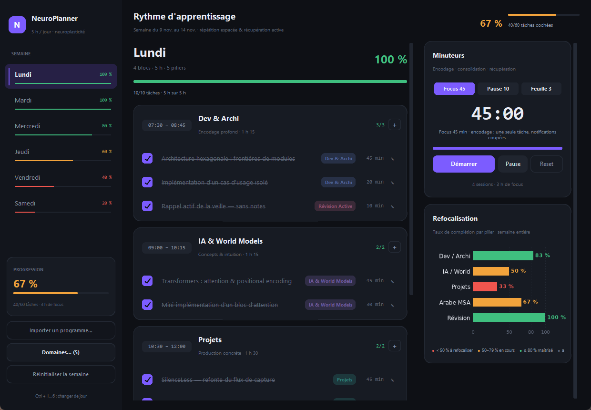
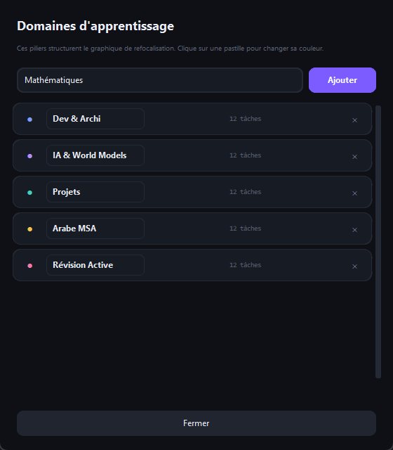
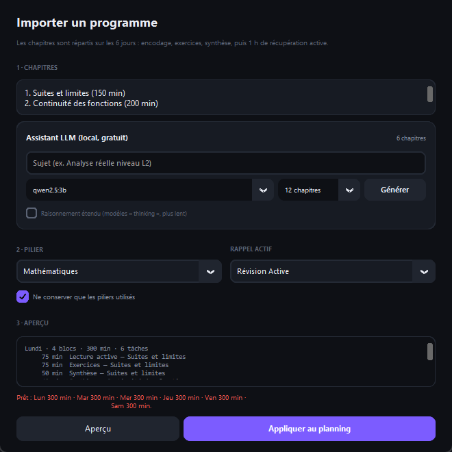

# NeuroPlanner

**Suivi d'un rythme d'apprentissage intensif (5 h / jour) fondé sur les principes de neuroplasticité.**

Application de bureau Python : navigation par jour, checklists persistées, minuteurs
d'encodage/consolidation/récupération, graphique de refocalisation par pilier — et un
**planning entièrement modifiable** (domaines, tâches, durées).



---

## Principes pédagogiques

| Principe | Traduction dans l'app |
|---|---|
| **Répétition espacée** | Un rappel actif de la veille ouvre chaque journée ; 6 jours couvrant les piliers. |
| **Récupération active** | Minuteur « Feuille blanche 3 min » et tâche de restitution libre en fin de bloc. |
| **Gestion de la charge cognitive** | Blocs de 1 h 15 / 1 h 30, un seul objectif par bloc, minuteur Focus 45 min. |

## Fonctionnalités

- **Navigation Lundi → Samedi**, 4 blocs horaires par jour (07:30 → 14:30), 5 h au total.
- **Checklists interactives** : chaque coche est écrite immédiatement sur disque.
- **Domaines d'apprentissage modifiables** : ajouter, renommer, recolorer, supprimer un
  pilier (la suppression retire ses tâches après confirmation).
- **Tâches modifiables** : ajout (`+` sur un bloc), édition et suppression (`✎` sur une
  ligne), avec contrôle du pilier et de la durée.
- **Import de programme** : colle une table des matières ou laisse un **LLM local
  (Ollama)** proposer les chapitres ; l'application répartit le tout sur les 6 jours,
  avec aperçu avant application.
- **Statistiques en direct** : avancement du jour, de la semaine, par pilier.
- **Minuteurs** : Focus 45, Pause 10, Feuille blanche 3 ; Démarrer / Pause / Reset, bip de fin.
- **Graphique de refocalisation** (Matplotlib) : rouge < 50 %, orange 50–79 %, vert ≥ 80 %,
  gris « vide » pour un pilier encore sans tâche.
- **Réinitialisation de la semaine** avec confirmation (les statistiques de focus sont conservées).
- **Raccourcis** `Ctrl+1` … `Ctrl+6` pour changer de jour.

| Gestion des domaines | Édition d'une tâche | Import d'un programme |
|---|---|---|
|  |  |  |

## Installation

Python **3.10+** requis.

```powershell
git clone https://github.com/youssefelbalibouhousse/NeuroPlanner.git
cd NeuroPlanner

python -m venv .venv
.venv\Scripts\Activate.ps1        # macOS / Linux : source .venv/bin/activate

pip install -e .
python main.py
```

Sans installation (les dépendances étant présentes) :

```powershell
pip install customtkinter matplotlib
python main.py
```

### Lancement

| Commande | Effet |
|---|---|
| `python main.py` | lance l'application |
| `python -m neuroplanner` | identique, via le module |
| `neuroplanner` / `neuroplanner-gui` | commandes installées par `pip install -e .` (la variante GUI n'ouvre pas de console sous Windows) |
| `python -m neuroplanner --data-file .\progression.json` | utilise un fichier de progression précis (le plan est créé à côté) |
| `python -m neuroplanner --plan-file .\mon_plan.json` | utilise un planning précis |

## Où sont mes données ?

Deux fichiers JSON distincts, écrits automatiquement :

| Fichier | Contenu |
|---|---|
| `neuro_progress.json` | cases cochées + statistiques (sessions, temps de focus) |
| `neuro_plan.json` | domaines, blocs horaires et tâches (le planning) |

Emplacements :

- Windows : `%APPDATA%\NeuroPlanner\`
- macOS : `~/Library/Application Support/NeuroPlanner/`
- Linux : `~/.local/share/NeuroPlanner/`

Surcharges : `--data-file`, `--plan-file`, ou les variables `NEUROPLANNER_DATA` et
`NEUROPLANNER_PLAN`. Ces fichiers ne sont jamais versionnés (voir `.gitignore`).

```json
{
  "version": 1,
  "domains": [{ "name": "Dev & Archi", "color": "#7C9CFF" }],
  "days": {
    "lun": [
      {
        "start": "07:30", "end": "08:45",
        "title": "Dev & Archi", "intent": "Encodage profond",
        "tasks": [
          { "id": "lun-0-0", "label": "Architecture hexagonale…", "domain": "Dev & Archi", "minutes": 45 }
        ]
      }
    ]
  }
}
```

L'écriture est atomique (fichier temporaire + `os.replace`) : une coupure ne peut
pas laisser un JSON tronqué. Un fichier illisible est mis de côté en
`*.corrupt.json` plutôt que d'être écrasé, et les identifiants de tâches inconnus
sont ignorés au chargement.

## Structure du projet

```text
NeuroPlanner/
├── main.py                     # point d'entrée pratique
├── pyproject.toml              # métadonnées, dépendances, ruff, pytest
├── neuroplanner/
│   ├── app.py                  # fenêtre principale (orchestration)
│   ├── config.py               # jours, chemins, version
│   ├── formatting.py           # formats (durées, dates, pourcentages)
│   ├── models.py               # modèles immuables (Task, Block, DayPlan, Domain…)
│   ├── theme.py                # palette, couleurs par domaine, polices
│   ├── data/
│   │   ├── curriculum.py       # programme par défaut (graine du plan)
│   │   ├── plan_store.py       # planning modifiable persisté
│   │   ├── presets.py          # préréglages des minuteurs
│   │   ├── store.py            # progression persistée
│   │   └── jsonfile.py         # lecture/écriture JSON atomique
│   ├── services/
│   │   ├── chapters.py         # lecture d'une table des matières
│   │   ├── generation.py       # chapitres → planning 5 h/jour
│   │   ├── llm.py              # client Ollama (chapitres par LLM local)
│   │   ├── countdown.py        # minuteur pur (testable sans écran)
│   │   ├── stats.py            # agrégations de progression
│   │   └── sound.py            # signal sonore de fin
│   ├── ui/                     # sidebar, day_view, block_card, task_row,
│   │                           # timer_panel, chart, header, dialogs,
│   │                           # import_dialog, widgets
│   └── assets/                 # icône et logo
├── tests/                      # 260 tests (dont intégration GUI)
├── docs/ARCHITECTURE.md        # modules, format du plan, pipeline d'import
└── tools/make_icon.py          # régénère l'icône
```

Détail des responsabilités, format du plan et recettes de modification :
[`docs/ARCHITECTURE.md`](docs/ARCHITECTURE.md).

## Personnaliser

Depuis l'interface, sans toucher au code :

- **Domaines** → bouton « Domaines… » de la barre latérale.
- **Tâches** → `+` dans l'en-tête d'un bloc, `✎` sur une ligne existante.
- **Couleur d'un domaine** → clic sur sa pastille (rotation dans la palette).

Dans le code :

- **Programme par défaut** → `neuroplanner/data/curriculum.py` (graine du premier lancement).
- **Minuteurs** → `neuroplanner/data/presets.py`.
- **Palette sombre** → `neuroplanner/theme.py` (`Palette`, `DOMAIN_PALETTE`).
- **Seuils de refocalisation** → `REFOCUS_BELOW` / `MASTERY_FROM` dans
  `neuroplanner/services/stats.py`.

## Générer un programme avec un LLM local

Principe : **le modèle propose la structure (chapitres), l'application construit le
planning**. Le résultat est donc prévisible, vérifiable dans l'aperçu, et
indépendant du modèle utilisé.

### 1. Installer un modèle local (gratuit, hors ligne)

```powershell
winget install Ollama.Ollama      # ou https://ollama.com/download
ollama pull qwen2.5:3b            # rapide (~17 s pour 12 chapitres)
ollama serve                      # généralement lancé automatiquement
```

### 2. Utiliser l'assistant

Barre latérale → **« Importer un programme… »** → décris le sujet → **Générer**.
Les chapitres proposés s'écrivent dans la zone de texte : relis-les, corrige-les,
puis **Aperçu** et **Appliquer au planning**.

Le mode « Table des matières » fonctionne sans LLM : colle simplement ta liste
(`1. Limites (90 min)`, `- Intégrales — 1 h 30`, …), la durée est facultative.

### Réglages

| Variable | Défaut | Rôle |
|---|---|---|
| `NEUROPLANNER_OLLAMA_URL` | `http://localhost:11434` | serveur Ollama (réseau local ou distant) |
| `NEUROPLANNER_LLM_MODEL` | `qwen2.5:3b` | modèle proposé par défaut |
| `NEUROPLANNER_LLM_THINK` | *(vide)* | `1` active le raisonnement étendu par défaut |

L'option **« Raisonnement étendu »** du dialogue correspond au paramètre `think`
d'Ollama (modèles `thinking`). Mesures sur une machine de test, 6 chapitres :

| Modèle | Mode | Durée | Qualité |
|---|---|---|---|
| `qwen2.5:3b` | normal | ~17 s | correct, chapitres un peu génériques |
| `gemma4` | normal | ~142 s | bon découpage |
| `gemma4` | raisonnement | ~161 s | meilleur enchaînement (suites → séries) |

Aucune clé d'API n'est nécessaire et aucun appel ne quitte la machine. Un
fournisseur hébergé (Groq, Gemini…) reste possible : il suffit d'implémenter le
même contrat `complete(prompt) -> str` — voir
[`docs/ARCHITECTURE.md`](docs/ARCHITECTURE.md#pipeline-dimport).

## Développement

```powershell
pip install -e ".[dev]"

python -m ruff check .            # lint
python -m pytest                  # tous les tests (ouvre des fenêtres)
python -m pytest -m "not gui"     # tests sans écran (CI)
python -m pytest --cov=neuroplanner --cov-report=term-missing
```

Les tests d'interface sont marqués `gui` : ils construisent une vraie fenêtre Tk
avec des fichiers temporaires, cochent des tâches, changent de jour, éditent le
plan via les dialogues, importent un programme et font tourner un minuteur
accéléré. Les appels au LLM sont simulés (transport factice) : la suite ne
nécessite ni réseau ni modèle installé.

## Feuille de route

- [x] Planning modifiable : domaines, tâches, durées.
- [x] **Génération du planning** à partir de chapitres, avec assistant LLM local
      (Ollama) et aperçu avant application.
- [ ] Fournisseur hébergé à palier gratuit (Groq / Gemini) derrière le même contrat.
- [ ] Historique multi-semaines et courbe de rétention.
- [ ] Thème clair commutable et export CSV.
- [ ] Packaging `PyInstaller` (exécutable Windows autonome).

## Licence

[MIT](LICENSE)
